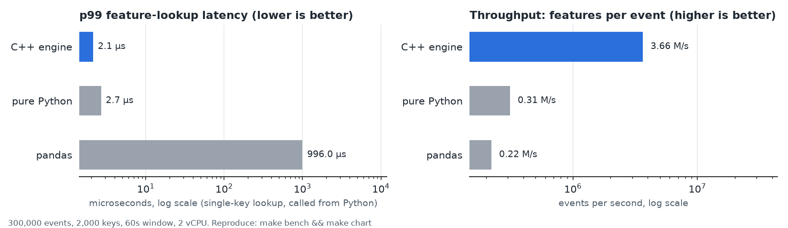

# MicroFeature: C++ Real-Time Feature Engine with Python Bindings

A low-latency C++17 engine that computes sliding-window features (store busy-ness, shopper
pick rate, ...) from an event stream, exposed to Python through pybind11 and benchmarked
against pure-Python and pandas implementations.



*300k events, 2k keys, 60 s window, 2-vCPU VM; regenerate with `make bench && make chart`.
Run-to-run variance is roughly +/-20%.* Headline numbers from that run:

| | C++ engine | pure Python | pandas |
|---|---:|---:|---:|
| p99 single-key lookup, called from Python | **2.1 us** | 2.7 us | 996 us (**~470x** slower) |
| Features computed per event (events/s) | **3.66 M** | 0.31 M | 0.22 M (**~17x** slower) |
| Ingest only, 1 / 4 threads (events/s) | 6.5 M / 9.0 M | 0.6 M | n/a |

**Read these honestly.** The pandas lookup baseline is the naive approach (per-key frame,
boolean-mask filter per lookup); a hand-written pure-Python dict of deques is competitive for a
*single* lookup because Python call overhead (~0.5 us) dominates. The engine's real wins are
batched/stream work (17x pandas, 12x pure Python), batched lookups (0.13 us per key at 1024 keys)
and native callers (~130 ns per lookup). Details: [docs/PERFORMANCE.md](docs/PERFORMANCE.md).

## Design note: memory layout and concurrency trade-offs

**Memory layout**
- A key's window is one contiguous power-of-two ring of 16-byte `{int64 ts, double value}`
  samples: ~16 B per buffered event, no per-event allocation, index math is `(head + i) & mask`.
  It starts at 8 slots and doubles on demand, so cold keys stay tiny and hot keys amortise growth.
- The ring is kept sorted by `(ts, value)`. In-order appends are O(1); a late event shifts only the
  few newer samples. Sorting costs a little on out-of-order input but buys *arrival-order-independent
  state*, which is what makes parallel ingestion testable against deterministic replay.
- Queries use two binary searches for the window bounds, then sum whichever side is smaller (the
  window or its expired complement) against a running total, so lookup cost tracks the number of
  *changed* samples rather than window size. The total is re-summed every 4096 evictions to bound drift.
- Keys live in `std::unordered_map` per shard. That is node-based (one pointer chase per lookup);
  an open-addressing table would be faster, but the map is not the bottleneck at the measured
  rates and stdlib behaviour keeps the code short and sanitizer-friendly.
- Each shard is `alignas(64)`, so one shard's mutex never shares a cache line with its neighbour
  (no false sharing).

**Concurrency**
- *Sharded mutexes, not lock-free.* `splitmix64(key) & mask` picks one of 64 shards; each has its
  own `std::mutex` and map. Critical sections are a few dozen ns, so contention is spread out and the
  design is easy to verify TSan-clean. A lock-free ring would need atomics over multi-field state
  (sum + EWMA + sorted insert); the complexity and memory-ordering risk were not worth it here.
- *Readers take the shard lock too.* Simple and consistent (a lookup never sees a half-updated key),
  at the cost of readers and writers on the same shard serialising. No RCU/seqlock snapshotting yet.
- *Batch calls lock per event, not per batch.* Fine-grained locking keeps latency for concurrent
  lookups bounded; the cost is a lock round-trip per event (~uncontended, ~tens of ns).
- *Hot keys serialise.* All events for one key hit one shard, so a single hot key cannot scale across
  threads (tested in `ManyThreadsHammeringOneKey`). Scaling comes from key diversity: 1 -> 4 threads
  gives 6.5 M -> 9.0 M events/s on this 2-vCPU VM, limited by the machine rather than the design.
- *Order independence over strict ordering.* Because state converges regardless of interleaving, no
  global ordering or sequencer is needed. The one exception is the per-key cap
  (`max_events_per_key`): dropping the oldest sample on overflow is arrival-order dependent, and is counted.
- *Python.* Ingestion and lookups release the GIL; NumPy buffers are read zero-copy.

## 45-second demo

`make showcase` (script: [scripts/demo_45s.sh](scripts/demo_45s.sh)) runs the whole sequence:
`make bench` (throughput and p50/p99 vs pure Python and pandas) -> `make chart` -> Python usage
([examples/usage.py](examples/usage.py)). The commands themselves take ~10 s, so for a 45 s recording
narrate each step:

| time | on screen | say |
|---|---|---|
| 0:00-0:05 | `make showcase` starts, `make bench` begins | "Same stream, three implementations." |
| 0:05-0:20 | benchmark tables print | "Features per event: 3.7 M/s in C++ vs 0.2 M/s in pandas. p99 lookup: microseconds vs about a millisecond." |
| 0:20-0:28 | open `docs/benchmark.png` | "Log scale; the pure-Python dict is close for a single lookup, the win is batch and stream work." |
| 0:28-0:45 | usage output | "NumPy in, `(n, 5)` NumPy out, GIL released, parallel ingest, unknown keys return count 0 / NaN." |

The Python usage shown at the end:

```python
import numpy as np, microfeature as mf

eng = mf.Engine(window_ms=60_000, halflife_ms=30_000)
eng.ingest_parallel(keys, ts_ms, values, threads=4)       # uint64 / int64 / float64 arrays
feats = eng.features(np.array([3, 7], dtype=np.uint64), now=ts_now)   # (2, 5) array
dict(zip(mf.FEATURE_NAMES, eng.lookup(3, ts_now)))        # single key
train_X = eng.replay_features(keys, ts_ms, values)        # point-in-time features per event
```

## CV line

> Built a C++ real-time feature engine with Python bindings that cut p99 feature latency ~470x vs. pandas at 3.7M events/sec, with TSan-verified concurrency.

Every number is reproducible from `make bench` (p99: 996 us pandas vs 2.1 us engine; 3.66 M
events/s). The pandas baseline is a naive per-lookup filter and the gain vs a tight pure-Python
dict is small for single lookups; be ready to say so in an interview.

## Features

- **Sharded in-memory store**: per-key time-ordered ring buffers computing sliding-window
  `count`, `sum`, `mean`, `rate_per_sec`, plus a time-decayed exponentially weighted mean (`ewma`).
- **Multi-threaded ingestion** (`ingest_parallel`) and a **deterministic replay mode**
  (`replay`, `replay_features`). A concurrency suite proves parallel ingestion converges to
  exactly the state replay produces, and runs clean under **ThreadSanitizer** and **ASan/UBSan**.
- **pybind11 module** `microfeature`: NumPy in, NumPy out (`(n, 5)` float64 feature matrices),
  GIL released during heavy loops. Parity tests compare against `pandas.rolling` / `ewm`.
- **Benchmark harness**: throughput and p50/p99 latency vs. pure Python and pandas
  (Python harness + Google Benchmark), with a `perf`/flame-graph script and notes.
- **ML demo**: streaming point-in-time features feed a scikit-learn model that predicts order
  fulfilment time.

## Architecture

```
            events (key, ts_ms, value)
                      |
        Engine  (include/microfeature/engine.hpp, src/engine.cpp)
   +------------------------------------------------------------+
   | shard = splitmix64(key) & mask      (64 shards by default) |
   |  +---------+  +---------+       +---------+                 |
   |  | mutex   |  | mutex   |  ...  | mutex   |  cache-line     |
   |  | hashmap |  | hashmap |       | hashmap |  aligned        |
   |  +----+----+  +---------+       +---------+                 |
   |       v                                                     |
   |  KeyState: RingBuffer<(ts,value)> sorted by (ts,value)      |
   |            running sum | EWMA numerator/denominator         |
   +------------------------------------------------------------+
        ^ ingest / ingest_parallel / replay        | query / query_batch
        |                                          v
   bindings/module.cpp (pybind11, NumPy) --> Python: benchmarks/, examples/, tests/python
```

Layout: `include/` + `src/` engine, `bindings/` pybind11, `tests/cpp` GoogleTest,
`tests/python` pytest parity/API tests, `bench/` Google Benchmark, `benchmarks/` Python
harness and baselines, `examples/ml_demo.py`, `scripts/perf_profile.sh`, `docs/PERFORMANCE.md`.

### Feature semantics

For a key and query time `now`, the window is **(now - window_ms, now]** (identical to
`pandas.rolling("Nms")`, closed on the right). `count/sum/mean/rate_per_sec` are over that
window. `ewma = sum(v_i * w_i) / sum(w_i)` with `w_i = 0.5^((T - t_i) / halflife)`, `T` being
the newest timestamp seen for the key (matches `pandas.ewm(halflife=..., times=...)`). Unknown
keys return `count=0` and NaN for `mean`/`ewma`.

## Setup

Requirements: a C++17 compiler (GCC/Clang), Python 3.9+ with `venv`, and network access on the
first build (CMake fetches GoogleTest and Google Benchmark if not installed system-wide).

```bash
make setup     # creates .venv with numpy, pandas, scikit-learn, matplotlib, pytest, cmake, ninja, pybind11
make build     # configures + builds engine, tests, benchmarks and the Python module into build/
```

No services or secrets are needed. Optional configuration is read from environment variables;
see `.env.example` for all of them (the Makefile does not require a `.env` file).

## Run

```python
import numpy as np, microfeature as mf

eng = mf.Engine(window_ms=60_000, halflife_ms=30_000)
eng.ingest(keys, ts_ms, values)                  # uint64 / int64 / float64 NumPy arrays
eng.ingest_parallel(keys, ts_ms, values, 4)      # multi-threaded, GIL released
feats = eng.features(np.array([3, 7], dtype=np.uint64), now=ts_now)   # (2, 5) array
dict(zip(mf.FEATURE_NAMES, eng.lookup(3, ts_now)))                    # single key
train_X = eng.replay_features(keys, ts_ms, values)   # point-in-time features per event
```

```bash
make showcase    # 45-second demo sequence: bench -> chart -> Python usage
make chart       # re-render docs/benchmark.png from the last `make bench`
make demo        # ML prediction loop (scikit-learn); prints MAE/R^2 with vs. without features
make bench       # Python harness: throughput + p50/p99 vs pure Python and pandas
make bench-cpp   # Google Benchmark, native
make perf        # perf record + optional flame graph (needs perf permissions)
```

Demo output (seeded, ~70k orders): MAE falls from 4.96 to 1.91 minutes (R^2 0.30 -> 0.89)
when the model gets streaming store busy-ness and shopper pick-rate features.

## Test

```bash
make test        # C++ (ctest, 24 tests) + Python (pytest, 13 tests)
make asan        # separate build with AddressSanitizer + UBSan, runs the C++ suite
make tsan        # separate build with ThreadSanitizer, runs the C++ suite
```

Everything above passes in the development environment. `docker build -t microfeature . &&
docker run --rm microfeature` runs the same build, tests and demo in a container (the Dockerfile
was written but not built in the development sandbox). GitHub Actions (`.github/workflows/ci.yml`)
runs tests, the demo, a benchmark smoke run, and the ASan and TSan jobs.

## Benchmark notes

Full tables, native Google Benchmark numbers and profiling notes: [docs/PERFORMANCE.md](docs/PERFORMANCE.md).
Flame graphs could not be captured in the benchmark sandbox (`perf_event_paranoid=4`); the script
(`make perf`) and notes are provided.

## Key design decisions

- **Low-contention rather than lock-free.** Keys are hashed to power-of-two, cache-line
  aligned shards, each with its own mutex and hash map. Contention is spread across shards,
  critical sections are tiny, and the design is easy to prove TSan-clean. A truly lock-free ring
  was rejected: with per-key sorted insertion and multi-field state (sum, EWMA) the complexity and
  memory-ordering risk outweighed the gain at these sizes. Queries take the same shard lock.
- **State is independent of arrival order.** Rings are sorted by `(ts, value)`, EWMA weights are
  relative to the newest timestamp, and late events are classified against the final watermark
  semantics. So N threads inserting in any interleaving reach the same window contents as the
  single-threaded **replay**, which makes correctness testable (exact buffer equality, sums to
  1e-6, EWMA to 1e-9; only float rounding order differs).
- **Event time, explicit `now`.** The engine has no wall-clock. Queries take `now`, so results
  are reproducible and expiry works with no new events arriving.
- **Retention.** Each key keeps samples only within `window_ms` of its newest event; queries
  for times before that (older than the retained window) are not answerable. Events already older
  than the watermark are *dropped* from the window (counted in `stats()["late_dropped"]`) but still
  update the EWMA. A per-key cap (`max_events_per_key`, default 2^20) bounds memory; overflow drops
  the oldest sample and is counted (this is the one case where state can depend on arrival order).
- **Cheap sums.** A running total is kept per key; queries sum whichever of the window or its
  complement is smaller, and the total is re-synchronised every 4096 evictions to bound drift.
- **Point-in-time features.** `replay_features(inclusive=False)` and the demo compute features
  *before* ingesting the event, preventing label/future leakage in training data.
- **NaN/inf values are rejected** (counted) because they would poison running sums.
- **Sanitizer builds exclude the Python module**: a sanitized runtime cannot be loaded into an
  unsanitized interpreter; the Python layer is covered by the normal build and tests.
- **Pandas parity caveat.** `pandas.rolling` is positional on identical timestamps, so the parity
  test uses unique timestamps per key.

## Limitations

- Single process, in-memory only; no persistence or networking.
- Timestamps are int64 milliseconds; keys are uint64 (hash/encode strings upstream).
- Per-key memory is O(events in window).
